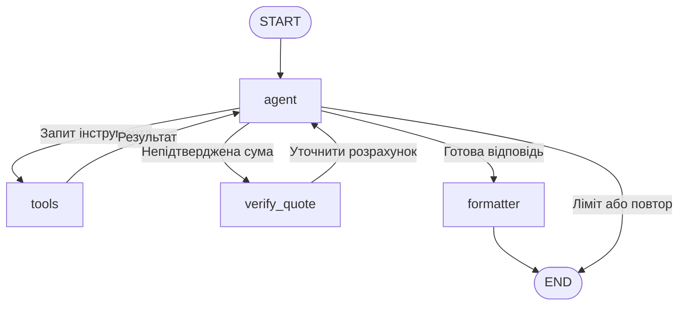

# ReAct-агент для планування матеріалів на заняття

**Домашнє завдання №1 - Дмитро Суров**

Вихователю потрібно закупити матеріали на групу, врахувати залишок у шафі та округлити покупку до цілих упаковок. Агент знаходить фасування й ціну в локальному каталозі, розраховує кількість упаковок і загальну вартість. Якщо користувач пропускає розмір групи, агент може попросити його уточнити. Мовна модель працює локально через Ollama.

## Домен та інструменти

Ціни в каталозі навчальні. Розрахунок охоплює один вид матеріалу, суми вказано в канадських доларах без податків та доставки.

| Матеріал    | Код       | Одиниць в упаковці | Ціна упаковки, CAD |
| ----------- | --------- | -----------------: | -----------------: |
| Папір       | `paper`   |                 25 |               4,50 |
| Клей-олівці | `glue`    |                  6 |               7,20 |
| Фломастери  | `markers` |                  8 |               6,40 |

| Інструмент   | Коли його викликає агент                         | Що він повертає                                                          |
| ------------ | ------------------------------------------------ | ------------------------------------------------------------------------ |
| `get_pack`   | Потрібне фасування або ціна матеріалу            | Код, фасування, ціна упаковки в центах і CAD                             |
| `plan_packs` | Відомі розмір групи, норма та фасування          | Загальна потреба, кількість упаковок до купівлі та залишок після заняття |
| `order_cost` | Відомі кількість упаковок і ціна однієї упаковки | Підсумок у центах і CAD                                                  |

Кожен інструмент має схему Pydantic v2 з описами параметрів і власним `field_validator`. Наприклад, `get_pack.invoke({"item": " PAPER "})` знаходить папір, а для `{"item": "watercolor"}` повертається помилка валідації з переліком доступних кодів. Для кількостей приймаються цілі числа. У графі помилка виклику надходить моделі як `ToolMessage` зі статусом `error`, тож вона може виправити аргументи.

## Як працює граф

`StateGraph` зберігає історію повідомлень, лічильник рішень, фінальну відповідь і причину зупинки. Вузол `agent` отримує опис інструментів через `bind_tools`. На початку доступний пошук у каталозі. Після першого успішного пошуку граф відкриває обидва калькулятори. `ToolNode` звіряє передані фасування й ціну з отриманим записом каталогу і повертає результат або повідомлення про помилку в історію. Коли модель дає текстову відповідь або ставить уточнення, `formatter` зберігає цей текст дослівно. Через `with_structured_output` з JSON Schema він одержує самооцінку `confidence`. Фінальна Pydantic-модель перевіряє три поля — `answer`, `confidence` і `sources`. Програма формує список джерел за успішними викликами в журналі.



| Обмеження         | Значення за замовчуванням | Що відбувається                                                                                                                                                                                       |
| ----------------- | ------------------------: | ----------------------------------------------------------------------------------------------------------------------------------------------------------------------------------------------------- |
| `max_steps`       |                        10 | Лічить рішення вузла `agent`. Інструмент, обраний на останньому дозволеному кроці, встигає виконатися. Перед наступним рішенням граф повертає вже отримані дані.                                      |
| `timeout_seconds` |                     120 с | Один дедлайн `asyncio.timeout` охоплює весь граф, включно з очікуванням відповіді та форматуванням. Перерваний вузол отримує в журналі позначку `interrupted`.                                        |
| `max_repeats`     |                         3 | Третій послідовний запит з однаковим ім’ям та аргументами зупиняє граф до виконання поточного пакета. Зміна параметрів починає лічбу заново. ID виклику та порядок ключів не впливають на порівняння. |

Якщо після підрахунку упаковок у чернетці з’являється вартість, `verify_quote` за потреби повертає агенту запит на перевірку. Підсумок у відповіді має збігатися з результатом `order_cost` для потрібної кількості упаковок і каталожної ціни. Повторне рішення теж використовує бюджет кроків.

При захисній зупинці `confidence` дорівнює 0, а відповідь містить причину і доступні результати. Кожен запит отримує власний журнал і детектор повторів.

## Запуск

Перевірено з Python 3.12, Ollama 0.11.10 і моделлю `qwen3:4b-instruct-2507-q4_K_M`. Для `asyncio.timeout` потрібен Python 3.11 або новіший. Розпакуйте ZIP, встановіть Ollama, запустіть застосунок і один раз завантажте модель. Завантаження моделі займає приблизно 2,5 ГБ. [Ollama для вашої системи](https://ollama.com/download) · [Сторінка моделі](https://ollama.com/library/qwen3:4b-instruct-2507-q4_K_M)

```sh
ollama pull qwen3:4b-instruct-2507-q4_K_M
ollama list
```

**Windows / PowerShell.** У каталозі з розпакованою папкою проєкту виконайте команди нижче. Віртуальне середовище можна використовувати без активації.

```powershell
cd hw1_react_agent
py -3.12 -m venv .venv
.\.venv\Scripts\python.exe -m pip install -r requirements.txt
.\.venv\Scripts\python.exe -m unittest -v test_tools test_agent
.\.venv\Scripts\python.exe test_runner.py --out-dir my_run
```

**Linux / macOS.** Команди також виконуються з каталогу, де видно папку `hw1_react_agent`.

```sh
cd hw1_react_agent
python3 -m venv .venv
.venv/bin/python -m pip install -r requirements.txt
.venv/bin/python -m unittest -v test_tools test_agent
.venv/bin/python test_runner.py --out-dir my_run
```

Щоб задати власне питання, запустіть `agent.py` тим самим інтерпретатором. Наприклад, у PowerShell можна виконати цю команду.

```powershell
.\.venv\Scripts\python.exe agent.py "Для 12 дітей потрібно по 2 фломастери. Є 3 фломастери. Скільки упаковок купити і скільки це коштуватиме?"
```

Відповідь з’явиться в консолі, а траєкторія одного запиту — у `trajectory_single.json`. Тестовий запуск з `--out-dir my_run` створить нові `my_run/test_results.json` та `my_run/trajectory.json`. Без цього параметра програма записує обидва файли в поточну папку. Стандартна адреса сервера — `http://127.0.0.1:11434`. Якщо сервер ще не працює, відкрийте Ollama або запустіть `ollama serve` в окремому терміналі. Ключ API для локальної моделі не потрібен.

## Результати тестування

П’ять предметних кейсів послідовно пройшли через локальну Qwen3 4B на CPU. У кожному випадку програма записала запит, очікування, дослівну відповідь, використані інструменти, їхні аргументи та тривалість. Статус враховує перевірки відповіді й фактично виконаних дій. [Результати](test_results.json) · [Траєкторії](trajectory.json)

| Кейс   | Запит                              | Рішення `agent` | Виконані інструменти                     |   Час, мс | Статус   |
| ------ | ---------------------------------- | --------------: | ---------------------------------------- | --------: | -------- |
| TC-001 | Папір, фасування й ціна            |               2 | `get_pack`                               | 44 057,55 | Пройдено |
| TC-002 | Клей для групи                     |               3 | `get_pack` → `plan_packs`                | 40 549,34 | Пройдено |
| TC-003 | Папір, запас і бюджет              |               4 | `get_pack` → `plan_packs` → `order_cost` | 52 893,68 | Пройдено |
| TC-004 | Невідомий розмір групи             |               1 | Без викликів                             | 15 929,58 | Пройдено |
| TC-005 | Фломастери, запас і перевірка ціни |               5 | `get_pack` → `plan_packs` → `order_cost` | 49 942,78 | Пройдено |

### Що показали запити

**Простий запит.** У TC-001 модель знайшла 25 аркушів і ціну 4,50 CAD за упаковку паперу. Їй вистачило одного пошуку та двох рішень. У TC-002 агент передав у калькулятор фасування з каталогу для клею. Для 18 дітей по 2 клей-олівці потрібно 36 одиниць, отже, 6 упаковок по 6.

**Складний запит.** У TC-003 один результат визначав вхід для наступної дії. Для 24 дітей потрібно 72 аркуші. У шафі вже є 10, тож треба докупити щонайменше 62. Три упаковки дають 75 аркушів, після заняття лишається 13, а покупка коштує 13,50 CAD. У журналі видно послідовність `get_pack`, `plan_packs`, `order_cost` та їхні аргументи.

**Брак даних.** У TC-004 фінальна відповідь була «Скільки дітей братимуть участь у занятті?». Запит не вказував кількості дітей. Калькулятори не запускалися, і агент не підставив типовий розмір групи.

**Перевірка вартості.** У TC-005 після використання трьох наявних фломастерів бракує 21. Три упаковки по 8 штук коштують 19,20 CAD. Граф повернув чернетку на перевірку (кількість таких подій у журналі — 1). У фінальній траєкторії є результат `order_cost` на 1920 центів.

**Де виникали помилки.** У пробній версії TC-003 модель підставила 50 аркушів в упаковці й повідомила вартість 24,50 CAD з упевненістю 0,95. Вона пропустила і пошук ціни, і розрахунок вартості. Pydantic прийняв 50 як допустиме ціле число. Після цього я додав перевірку походження фасування й ціни. В іншому прогоні вузол `agent` правильно запитав кількість дітей у TC-004, але форматування перетворило запитання на констатацію. Тепер текст переходить у фінальну модель дослівно. Окрема перевірка команди з інструкції виявила ще один пропуск. Агент назвав правильні 19,20 CAD, але порахував їх самостійно. До графа додано перевірку грошового підсумку, а цей запит увійшов до набору як TC-005. Три регресійні тести відтворюють ці ситуації. [Тести виправлень](test_agent.py)

**Кроки й час.** Простий, середній та складний розрахунки потребували відповідно двох, трьох і чотирьох рішень моделі. Окремий виклик для `confidence` входить у загальний час. TC-001 тривав 44,06 с, TC-002 — 40,55 с, TC-003 — 52,89 с. Перший запит включав завантаження моделі в пам’ять. На час також впливає довжина відповіді. Один прогін на CPU дає виміри для цих кейсів без оцінки середньої затримки.

У фінальному прогоні всі необхідні інструменти спрацювали. Найдовший за кількістю рішень запит використав 5 із 10 кроків. Жоден із п’яти запитів не досяг обмеження за часом або кількістю кроків.

### Як спрацювали захисні механізми

У трьох окремих перевірках тестовий драйвер задає дії моделі або затримку. Вони запускають той самий граф з його `ToolNode`, журналом та загальним таймером. Поле `backend` у цих записах має значення `controlled_test_driver`.

| Кейс | Умова                               | Спостереження                                                                          | Причина зупинки |
| ---- | ----------------------------------- | -------------------------------------------------------------------------------------- | --------------- |
| G-01 | Ліміт в одне рішення                | Виконано один пошук. Часткова відповідь містить фасування та ціну паперу.              | `max_steps`     |
| G-02 | Тричі запропоновано той самий пошук | Два виконання. Третій запит видно у вузлі `agent`, після нього записано подію `guard`. | `loop_detected` |
| G-03 | Затримка 2 с за бюджету 0,15 с      | Активний запит перервано. Увесь запуск тривав 151,68 мс. Викликів інструментів — 0.    | `timeout`       |

Сім окремих тестів перевіряють інструменти на валідних і невалідних аргументах, точному поділі, округленні та достатньому запасі. Ще три тести перевіряють виправлення в графі. Усі десять пройдено. [Тести інструментів](test_tools.py) · [Тести графа](test_agent.py)

## Висновки та обмеження

Калькулятори дають змогу перевірити розрахунок вручну, а журнал показує момент, коли з’явилося конкретне число. Надійність відповіді залежить і від того, як модель розпізнала кількість дітей та норму в тексті. П’ять кейсів охоплюють один матеріал за запит. Для замовлення з кількох позицій знадобилися б прив’язка розрахунку до кожного товару й підсумовування рядків кошика. Значення `confidence` є самооцінкою, її калібрування на більшій вибірці не проводилося.

## Файли проєкту

| Файл                             | Призначення                                                           |
| -------------------------------- | --------------------------------------------------------------------- |
| `tools.py`                       | Каталог, три схеми Pydantic і три доменні інструменти                 |
| `agent.py`                       | Граф, модель Ollama, контроль походження чисел і запуск одного запиту |
| `safety.py`                      | Ліміти запуску та детектор послідовних повторів                       |
| `logger.py`                      | Вхід і вихід вузлів, виклики, UTC-мітки та тривалість кожного кроку   |
| `test_tools.py`, `test_agent.py` | Окремі й регресійні тести                                             |
| `test_runner.py`                 | Запуск кейсів, оцінювання відповідей і демонстрації захисту           |
| `test_results.json`              | Очікувані й фактичні результати з перевірками та метриками            |
| `trajectory.json`                | Події кожного запуску з тим самим `run_id`, що й у результатах        |
| `requirements.txt`, `README.md`  | Залежності, інструкція та аналіз                                      |

Технічні довідки. [Графи LangGraph](https://docs.langchain.com/oss/python/langgraph/graph-api) · [Інструменти LangChain](https://docs.langchain.com/oss/python/langchain/tools) · [Інтеграція з Ollama](https://docs.langchain.com/oss/python/integrations/chat/ollama)
